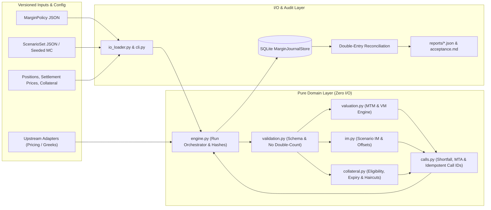

# Architecture — Derivatives Margin Engine

## 1. Component Overview & Data Flow

The engine strictly separates **pure domain analytics** (deterministic, side-effect-free `Decimal` computations) from **I/O boundaries** (JSON loading, CLI, adapters, and SQLite ledger persistence).

## 2. Module Responsibilities

| Module | Layer | Responsibility |
|---|---|---|
| `models.py` | Domain | Frozen immutable dataclasses, strict `to_decimal` (rejects floats), `quantize_amount`, canonical JSON hashing |
| `errors.py` | Domain | Typed exception hierarchy with stable machine-readable error codes |
| `validation.py` | Domain | Policy, scenario, position, price, and collateral contract checks; duplicate lot enforcement |
| `valuation.py` | Domain | Per-position MTM and daily VM computation (`daily_mtm_movement - settled_cash_adjustment`) |
| `im.py` | Domain | Scenario shocks (`RELATIVE`/`ABSOLUTE`), intra-group and cross-group offsets, `WORST_CASE`/`HISTORICAL_VAR`/`EXPECTED_SHORTFALL`, deterministic seeded MC generator |
| `collateral.py` | Domain | Maturity/expiry eligibility, maturity-bucket haircut matching, FX mismatch add-on, single-class concentration cap |
| `calls.py` | Domain | Shortfall/excess calculation, MTA deferral, ceiling rounding, settlement correction calls, deterministic `idempotency_key` and `call_id` |
| `engine.py` | Domain | Pure orchestration, content SHA-256 hashes, deterministic `run_id`, structured JSON diagnostic logs |
| `journal.py` | Persistence | SQLite ACID transactions, immutable settlement snapshot history, duplicate-call rejection, idempotent replay, double-entry ledger, reconciliation verifier |
| `io_loader.py` | I/O | File loading with explicit missing-config/malformed-JSON diagnostics and pretty-printed canonical JSON output |
| `adapters.py` | Integration | Runnable protocols and reference adapters (`StaticPricingAdapter`, `LinearizedGreeksScenarioAdapter`) |
| `cli.py` | I/O | Subcommands: `evaluate`, `replay`, `reconcile`, `verify-oracle` |

## 3. Core Invariants

1. **VM Accounting Identity:** For every position and netting set,
   `variation_margin == daily_mtm_movement - settled_cash_adjustment`
   is asserted in exact quantized `Decimal` arithmetic.
2. **No Double-Counted Collateral:** Enforced at **two independent layers**:
   - Domain validation rejects duplicate `lot_id` across all netting sets (`DuplicateCollateralError`).
   - SQLite `collateral_allocations` enforces `PRIMARY KEY (valuation_date, revision, lot_id)`.
3. **No Duplicate Margin Calls:** Every call has a deterministic `idempotency_key = "{valuation_date}|{netting_set_id}|{call_type}|rev{revision}"` backed by a `UNIQUE` index in `margin_calls`. Strict mode raises `DuplicateMarginCallError`; `--allow-rerun` permits exact hash-matched idempotent replays without posting new entries.
4. **Immutable Settlement Corrections:** Correcting a settlement price requires incrementing `revision` (`revision >= 2`) with `is_settlement_correction=True` and verifies revision `revision - 1` exists in SQLite. Prior snapshots and calls are never mutated; an explicit `SETTLEMENT_CORRECTION` call and journal posting record the delta.
5. **Balanced Double-Entry Journal & 1:1 Call Reconciliation:** Every persisted margin call emits balanced debit/credit rows (`sum(debit) == sum(credit)` per currency and per call), verified by `reconcile_journal()`.

## 4. Key Trade-Offs

- **Pure stdlib (`Decimal` + `sqlite3`) vs. external frameworks:** Eliminates dependency drift and binary floating-point rounding discrepancies, trading away multi-writer concurrency (PostgreSQL) and vectorized C/NumPy throughput for extreme portfolio sizes (>100k positions).
- **Linear scenario revaluation:** Fast, transparent, and hand-verifiable for educational margin modeling; non-linear option portfolios require an upstream repricing adapter feeding instrument-level scenario P&L shocks.
- **Deterministic SHA-256 identifiers:** `run_id`, `call_id`, and `entry_id` are content-derived rather than random UUIDs, guaranteeing identical outputs across repeated clean runs.
