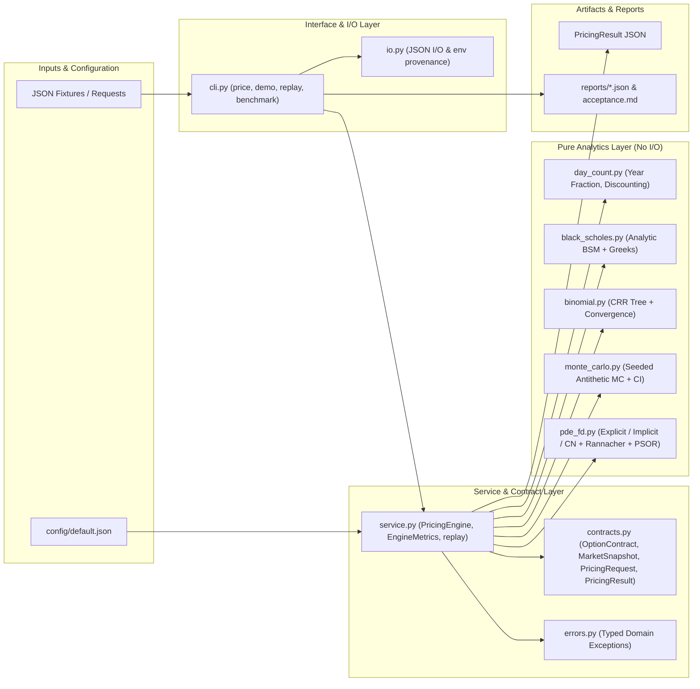

# Architecture — Derivatives Pricing Engine

## 1. Component Overview

The engine is organized into four cleanly separated layers so domain mathematics remain pure, testable, and independent of serialization or CLI orchestration.

## 2. Data Flow

1. **Ingress & Schema Validation:** Raw JSON payloads or Python objects are parsed into immutable dataclasses (`OptionContract`, `MarketSnapshot`, `PricingRequest`). All timestamps are validated as timezone-aware and normalized to UTC; numeric bounds and supported enums are enforced immediately.
2. **Configuration & Parameter Resolution:** `PricingEngine` merges method defaults from `config/default.json` with per-request `method_params`, rejecting unknown parameter keys with `VALIDATION_ERROR`.
3. **Convention Resolution:** `day_count.year_fraction` computes `time_to_maturity` ($T \ge 0$) under the contract's explicit day-count convention.
4. **Pure Domain Valuation:** The request dispatches to the selected solver in `analytics/`. Each solver checks method-specific constraints (exercise style compatibility, no-arbitrage probability bounds, CFL stability) before computing valuation and diagnostics.
5. **Versioned Result Assembly:** `PricingEngine` wraps outputs into a `PricingResult` stamped with `schema_version`, `engine_version`, a deterministic content-addressed `result_id`, runtime environment provenance, and structured metrics counters.

## 3. Core Invariants

- **Put-Call Parity (European):** $C - P = S e^{-qT} - K e^{-rT}$ to machine precision ($\le 10^{-12}$) in Black-Scholes across all valid $(S, K, T, r, q, \sigma)$.
- **No-Arbitrage Bounds:**
  - European Call: $\max(S e^{-qT} - K e^{-rT}, 0) \le C \le S e^{-qT}$.
  - European Put: $\max(K e^{-rT} - S e^{-qT}, 0) \le P \le K e^{-rT}$.
  - American Option: $V_{\text{American}} \ge \max(V_{\text{European}}, \text{intrinsic})$.
- **Zero-Maturity & Zero-Volatility Limits:** All four engines explicitly handle $T = 0$ and $\sigma = 0$ without division-by-zero or NaN propagation.
- **American Call with Zero Dividend:** When $q = 0$ and $r \ge 0$, early exercise of an American call is never optimal, so $C_{\text{American}} = C_{\text{European}}$.
- **Deterministic Reproducibility:** Identical inputs, config, and PRNG seeds produce identical `result_id` and identical `unit_price` on replay.

## 4. Solver Trade-Offs

| Solver | Supported Styles | Convergence Rate | Strengths | Trade-Offs / Limitations |
|---|---|---|---|---|
| `black_scholes` | European only | Exact (machine precision) | Instant ($\sim 10\,\mu\text{s}$), closed-form Greeks, reference oracle | Constant flat $\sigma$, European only |
| `binomial` (CRR) | European, American | $O(1/N)$ (with even/odd oscillation) | Simple early-exercise handling, direct tree Greeks | Slower asymptotic convergence than Crank-Nicolson PDE |
| `monte_carlo` | European only | $O(1/\sqrt{M})$ with antithetic variance reduction | Scales to higher dimensions; explicit statistical CI | Stochastic noise; plain MC does not support American exercise |
| `pde_fd` (CN + Rannacher + PSOR) | European, American | $O(\Delta S^2 + \Delta\tau^2)$ | Fast 2nd-order convergence for both European and American options, full $S$-profile Greeks | Truncated domain $[0, S_{\max}]$; explicit scheme requires restrictive CFL $\Delta\tau \propto \Delta S^2$ |
