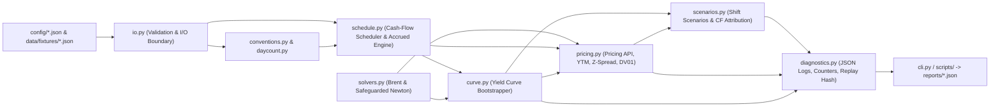

# Architecture — Fixed Income Analytics Engine

## 1. System overview and component boundaries

The engine strictly separates **pure domain mathematics** (day-count arithmetic, cash-flow scheduling, yield-curve bootstrapping, pricing/sensitivities, and scenario attribution) from **I/O, configuration loading, structured logging, and CLI orchestration**.

## 2. Core modules and responsibilities

| Module | Layer | Responsibility |
|---|---|---|
| `conventions.py` | Domain | Explicit enums (`Currency`, `DayCountConvention`, `BusinessDayConvention`, `Compounding`, `InterpolationMethod`, `StubType`) and deterministic synthetic holiday calendars. |
| `daycount.py` | Domain | Exact year fractions (`ACT/360`, `ACT/365F`, `ACT/ACT_ICMA`, `30/360_US`, `30E/360`) and end-of-month-aware date stepping. |
| `models.py` | Domain Contracts | Immutable, self-validating dataclasses (`BondSpec`, `CashFlowSchedule`, `DepositQuote`, `BondQuote`, `CurveNode`, `PricingResult`, `ScenarioResult`, `ValuationConfig`) and deterministic SHA-256 content IDs. |
| `schedule.py` | Domain | Regular backward/forward and irregular stub (short/long front/back) coupon scheduler, ICMA Rule 251 stub proration, and accrued-interest engine. |
| `solvers.py` | Numerical Core | Zero-dependency bracketed Brent (`brentq`) and safeguarded Newton-Raphson (`newton_safeguarded`) with iteration counters and `ConvergenceError` reporting. |
| `curve.py` | Domain | Sequential deposit + bond discount-factor bootstrapping, `LOG_LINEAR_DF` and `LINEAR_ZERO` interpolation, flat-forward / flat-zero extrapolation, repricing residual audits, and curve shift transformations. |
| `pricing.py` | Analytics & Pricing API | Analytic price/yield derivatives, YTM solver, Z-spread solver, Macaulay/Modified duration, convexity, analytic vs central finite-difference DV01 comparison, curve parallel DV01, and key-rate DV01. |
| `scenarios.py` | Analytics | Parallel, steepener, flattener, butterfly, and node-specific rate shocks with exact per-cash-flow PV attribution and Taylor duration/convexity decomposition. |
| `diagnostics.py` | Observability | Structured JSON event log, diagnostic counters, runtime environment metadata, and volatile-field-stripped logical fingerprint for deterministic replay. |
| `io.py` & `cli.py` | I/O & Interface | Versioned JSON loading/writing, `ConfigurationError` handling, and `fi-analytics run|replay` CLI commands. |

## 3. Domain invariants

1. **Cash-flow conservation:** For every schedule, `total_coupons + total_principal == total_cash_flows` within `1e-9`.
2. **Clean/dirty decomposition:** For every valuation, `clean_price + accrued_interest == dirty_price` and `sum(cf.present_value) == dirty_price` with `sum(cf.pv_weight) == 1.0`.
3. **Curve anchor and positivity:** `DF(0) == 1.0`, node times are strictly increasing (`t_{i+1} > t_i`), and `DF(t_i) > 0`. Unless `allow_negative_zero_rates=True`, `DF(t_i) <= 1.0`.
4. **Calibration auditability:** Every bootstrapped curve reprices all calibration deposits and bonds and records per-instrument `CalibrationResidual` entries; exceeding `repricing_tolerance_bp` raises `CalibrationError` instead of succeeding silently.
5. **Scenario attribution conservation:** Under every curve shift, `sum(cf.pv_change) == total_pnl` (`reconciliation_error <= 1e-9`).
6. **Deterministic logical outputs:** Given identical versioned config and fixture inputs, `curve_id`, `pricing_id`, `result_id`, and `logical_fingerprint` are bit-for-bit identical across runs.

## 4. Architecture Decision Record (ADR-001)

### ADR-001: Zero-dependency deterministic Python core with explicit conventions and log-linear DF bootstrapping

- **Status:** Accepted
- **Context:** Fixed-income prototypes frequently suffer from hidden library defaults (e.g., implicit day-count fallbacks, silent calendar differences) or brittle native-binary installation constraints (QuantLib wheels across platforms).
- **Decision:**
  1. Implement the core domain engine in pure Python 3.9+ standard library (`math`, `datetime`, `dataclasses`, `hashlib`, `json`) with exact Brent and safeguarded Newton-Raphson solvers (`solvers.py`).
  2. Require explicit conventions on every instrument and configuration (`currency`, `day_count`, `business_day_convention`, `calendar_name`, `compounding`, `interpolation`, `valuation_date`, `valuation_time_utc`).
  3. Default yield-curve interpolation to `LOG_LINEAR_DF` (equivalent to piecewise-constant instantaneous forward rates, guaranteeing strictly positive discount factors) with `LINEAR_ZERO` available as an explicit alternative.
  4. Validate accuracy against independent closed-form analytical oracles (`data/fixtures/reference_hand_calculated.json`) and central finite-difference numerical bumps. Keep NumPy/SciPy/QuantLib as optional comparison extras in `pyproject.toml`.
- **Consequences:**
  - *Positive:* Reproducible offline execution with zero mandatory external dependencies, transparent line-by-line auditability, and `< 1e-9 bp` calibration precision.
  - *Trade-offs:* Pure Python is slower than vectorized C++/NumPy for 100k-bond Monte Carlo portfolios; spline interpolation (e.g., monotone convex / cubic zero) and optionality (callable/putable OAS) remain out of scope for v0.1.
