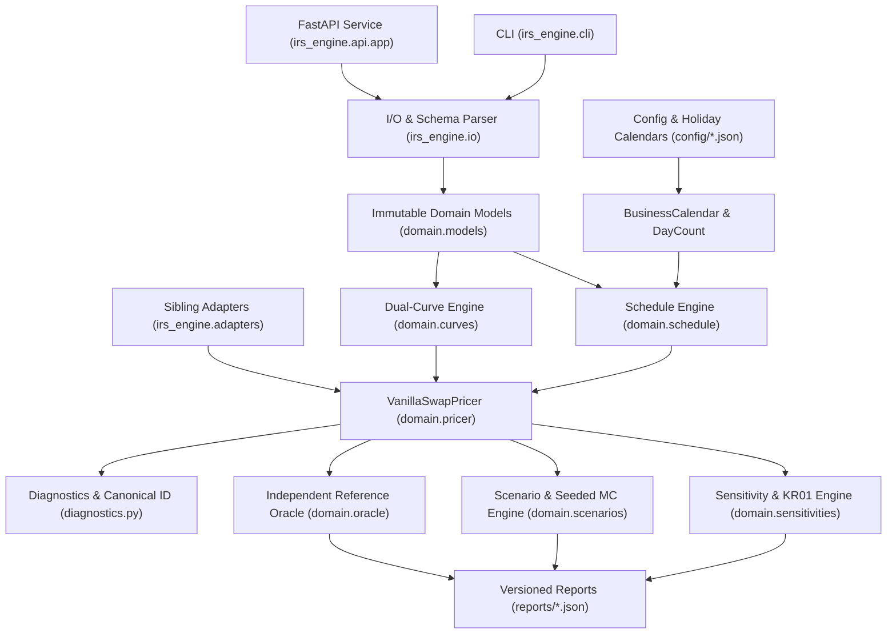

# Architecture — Interest Rate Swaps Engine

## 1. Component Overview

The engine enforces a strict separation between **pure financial domain analytics** (zero I/O, zero web framework dependencies, deterministic pure functions over immutable dataclasses) and **interface/delivery layers** (JSON I/O, FastAPI REST transport, CLI, and integration adapters).

---

## 2. Data Flow

1. **Ingress & Validation:** Trade terms, discount curve snapshot, forward curve snapshot, fixing history, and valuation config are parsed via `irs_engine.io` (or Pydantic schemas in `irs_engine.api.schemas`) into frozen domain dataclasses. Invalid currencies, non-positive notionals, inverted dates, or non-monotonic curve pillars fail immediately with typed `IRSEngineError` subclasses.
2. **Schedule Construction:** `domain.schedule` rolls unadjusted dates backward (for `NONE`, `FRONT_SHORT`, `FRONT_LONG`) or forward (for `BACK_SHORT`, `BACK_LONG`), applies optional EOM preservation across leap years, adjusts accrual boundaries via the leg's `BusinessCalendar`, computes ISDA day-count fractions, and applies signed business-day offsets for fixing and payment lags.
3. **Dual-Curve Evaluation:** `domain.curves.YieldCurve` evaluates discount factors $DF_{\text{disc}}(t)$ on the discount curve and simply-compounded forward rates $L_i = \frac{1}{\tau_i}\left(\frac{DF_{\text{fwd}}(t_s)}{DF_{\text{fwd}}(t_e)} - 1\right)$ on the forward projection curve.
4. **Fixing Resolution & Cashflow Discounting:** For each floating period:
   - `payment_date <= valuation_date` -> `SETTLED` (`present_value = 0.0`).
   - `fixing_date < valuation_date` -> resolved from `FixingHistory` (`HISTORICAL`), or raises `MissingFixingError` (unless `PROJECT_FALLBACK` is explicitly configured).
   - `fixing_date >= valuation_date` -> projected from the forward curve (`PROJECTED`, or `HISTORICAL` if provided on `valuation_date`).
   Both fixed and floating cashflows are discounted strictly on the **discount curve**.
5. **Risk, Scenarios & Verification:**
   - `domain.sensitivities` perturbs discount and forward curves independently and jointly (parallel and per-pillar) using central or forward finite differences, verifying $\sum \text{KR01} \approx \text{PV01}_{\text{parallel}}$.
   - `domain.scenarios` applies declarative deterministic curve shocks (parallel, twist, butterfly, basis) and fixed-seed 3-factor PCA + basis Monte Carlo shocks.
   - `domain.oracle` independently re-values cashflows and solves the par rate via 100-iteration numerical bisection without reusing `YieldCurve` or the analytic annuity par-rate formula.

---

## 3. Core Mathematical Invariants

| Invariant | Formula / Condition | Verified By |
|---|---|---|
| **Payer/Receiver Sign Symmetry** | $\text{PV}_{\text{payer}} + \text{PV}_{\text{receiver}} = 0$, $\text{PV01}_{\text{payer}} + \text{PV01}_{\text{receiver}} = 0$ | `test_pricer_domain.py`, `test_sensitivities.py` |
| **At-Market Par Rate Identity** | $K^* = \frac{\text{PV}_{\text{float}}}{N \cdot \sum \tau_j DF_{\text{disc}}(t_j)} \implies \text{PV}(K^*) = 0$ | `test_pricer_domain.py` |
| **Dual-Curve Separation** | `discount_curve.role == DISCOUNT`, `forward_curve.role == FORWARD`, distinct cashflow projection vs discounting | `test_pricer_domain.py`, `test_boundaries_and_errors.py` |
| **Single-Curve Telescoping Identity** | For flat single curve, $s=0$, spot start: $\text{PV}_{\text{float}} = N(1 - DF(t_n))$ | `test_pricer_domain.py`, `oracle_comparison.json` |
| **KR01 Partition-of-Unity Reconciliation** | For `LINEAR_ZERO` interpolation, $\sum_k \text{KR01}_k^{\text{disc}} + \sum_m \text{KR01}_m^{\text{fwd}} \approx \text{PV01}_{\text{parallel}}$ | `test_sensitivities.py`, `sensitivities_report.json` |
| **Deterministic Replayability** | Identical canonical inputs + seed yield identical `valuation_id` and bit-for-bit identical outputs | `test_scenarios_and_repro.py` |

---

## 4. Key Trade-Offs

- **Pure Python 3.12 stdlib Domain Core vs NumPy/QuantLib:** Implementing interpolation (including a Thomas-algorithm natural cubic spline solver), schedule rolling, and pricing in pure stdlib Python guarantees zero native wheel/ABI friction, sub-second test runs (41 tests in ~0.33s), and deterministic cross-platform reproducibility. QuantLib is supported as an optional oracle adapter rather than a hard build dependency.
- **Zero-Rate `CurveSnapshot` Inputs vs In-Engine Bootstrapping:** Accepting explicit zero-rate curves keeps the swap valuation boundary clean and auditable; curve bootstrapping belongs in a dedicated upstream curve-construction service behind `CurveProviderPort`.
- **Fail-Fast Missing Fixings:** Defaulting `missing_fixing_policy` to `ERROR` prevents silent mispricing of seasoned swaps when fixing history is incomplete.
