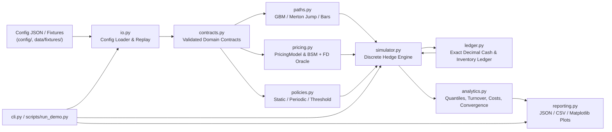

# Architecture — Options Hedging Simulator

## 1. Design Goals & Boundaries

The Options Hedging Simulator isolates stochastic path generation, option valuation/Greeks, discrete rebalancing policies, self-financing currency-precision accounting, and post-simulation analytics into decoupled, typed modules.

Key architectural boundaries:
- **Pricing API vs. Simulation/Analytics**: `PricingModel` (`src/options_hedging_simulator/pricing.py`) exposes a minimal `price_and_greeks(...) -> OptionQuote` protocol. Simulation (`simulator.py`) and analytics (`analytics.py`) never depend on Black-Scholes internals directly and can consume any compliant pricing adapter.
- **Pure Domain Logic vs. I/O**: `contracts.py`, `pricing.py`, `paths.py`, `policies.py`, `ledger.py`, `simulator.py`, and `analytics.py` operate purely on in-memory typed dataclasses and NumPy arrays (with the single exception of `load_historical_bars` for CSV fixture ingestion). File I/O, JSON/CSV serialization, runtime metadata, and Matplotlib plotting live strictly in `io.py`, `reporting.py`, and `cli.py`.
- **Explicit Conventions**: Currency, minor-unit precision (`USD`/`EUR`/`GBP` = 2 decimals, `JPY` = 0 decimals), day-count (`ACT/365F`, `BUS/252`), compounding (`continuous`, `simple`), and valuation time (`16:00:00Z`) are explicit fields on `PricingConventions`.

## 2. Component Diagram

## 3. Data Flow & Step Execution Lifecycle

For each `SpotPath` of length $N + 1$ ($t_0 = 0 < t_1 < \dots < t_N = T$):
1. **Inception ($t_0$)**:
   - Reject stale initial quotes (`StalePriceError`).
   - Value option with `PricingModel` at $(S_0, T, r, q, \sigma_{\text{hedge}})$.
   - Book initial option premium (`+V_0 Q` for short option, `-V_0 Q` for long option), execute initial hedge trade (`-option_sign * Q * delta_0`), apply half-spread and fees, quantize every cash component to currency minor units.
2. **Intermediate Steps ($t_1 \dots t_{N-1}$)**:
   - Accrue cash financing interest over $\Delta t$ (applying `cash_borrow_spread_bps` when cash balance is negative) and continuous/simple dividend cash on held underlying inventory.
   - Check staleness flags according to `stale_price_policy` (`skip`, `use_last`, or `error`).
   - Query `HedgePolicy.decide(...)` and execute rebalance trades (respecting `share_lot_size` and `min_trade_shares`).
   - Record step entry in `SelfFinancingLedger` and assert step-level cash & inventory invariants.
3. **Expiry Settlement ($t_N = T$)**:
   - Accrue final period financing and dividends.
   - Evaluate intrinsic payoff and exercise status.
   - Execute either **cash settlement** (book cash payoff and unwind all held shares at $S_T$) or **physical exercise/assignment** (deliver/receive $Q$ shares at strike $K$ when ITM and unwind only the residual inventory at $S_T$).
   - Run full cumulative `ledger.verify_reconciliation(expect_flat_inventory=True)` asserting `Decimal("0.00")` residual and `shares_after == 0.0`.

## 4. Core Invariants

| Invariant | Enforcement Point | Failure Mode |
|---|---|---|
| Step cash identity: $C_t = C_{t-1} + I_t + D_t + \text{MidCF}_t - \text{Spread}_t - \text{Fee}_t + \text{OptCF}_t$ | `SelfFinancingLedger.record_step` | `LedgerImbalanceError` |
| Cumulative cash identity across full path | `SelfFinancingLedger.verify_reconciliation` | `LedgerImbalanceError` |
| Terminal inventory flatness ($h_T = 0$) | `SelfFinancingLedger.verify_reconciliation` | `LedgerImbalanceError` |
| Non-negative transaction costs | `SelfFinancingLedger.record_step` | `LedgerImbalanceError` |
| Deterministic fill replay (`fills_digest` SHA-256) | `io.verify_replay` | `ReplayMismatchError` |
| Explicit stale price handling | `simulator.simulate_path` | `StalePriceError` (under `error`) or explicit diagnostic counter |

## 5. Key Trade-offs & Limitations

- **Currency-precision quantization vs. floating-point drift**: Rounding every individual cash flow leg to minor units (`ROUND_HALF_EVEN`) guarantees exact ledger balancing (`0.00` residual) and auditable fills at the expense of sub-cent quantization noise (~$0.005 per leg), which is negligible for realistic notional sizes and transparent in step ledgers.
- **Memory vs. granularity in Monte Carlo batches**: Full step-by-step `LedgerEntry` rows are retained for the first `store_entries_limit` paths (default 5) while exact running reconciliation and full `FillRecord` digests are computed across all paths.
- **Model scope**: Only European calls and puts under constant-parameter Black-Scholes-Merton delta are implemented natively. Discrete hedging does **not** eliminate jump/gap risk, stochastic volatility, or liquidity slippage during stress events.
