# Architecture — Volatility Surface Engine

## 1. Component Architecture & Data Flow

```mermaid
flowchart LR
    Input["OptionChainSnapshot (JSON / Typed API)"] --> Val["validation.py\nSchema, Conventions, Timestamps"]
    Cfg["CalibrationConfig (default_config.json)"] --> Val
    Val --> Fwd["cleaning.py\nPut-Call Parity Forward Estimation"]
    Fwd --> Clean["cleaning.py\nBid/Ask Hygiene & OTM Wing Selection"]
    Clean --> B76["black76.py\nBounds Check & Safeguarded IV Inversion"]
    B76 --> SVI["svi.py\nBid-Ask Weighted Raw SVI Fit"]
    B76 --> SABR["sabr.py\nBid-Ask Weighted SABR Benchmark"]
    SVI --> Surf["surface.py\nPiecewise-Linear Total Variance w(k,T)"]
    SABR --> Surf
    Surf --> Arb["arbitrage.py\nDurrleman Density, Call Convexity, Calendar Check"]
    Arb --> Snap["SurfaceSnapshot\nVersioned JSON + Deterministic surface_id"]
    Snap --> Query["VolatilitySurface.query()\nStrict Domain Bounds & Extrapolation Guard"]
    Snap --> Export["viz.py / Polars\nPlotly 3D HTML & Slice Tables"]
```

## 2. Module Boundaries

Core analytics are isolated from file I/O and CLI orchestration:

- **Domain Models (`models.py`)**: Pure frozen dataclasses, schema versions, deterministic config hashing, and typed error hierarchy (`VSEError` subclasses). No file or network I/O.
- **Validation (`validation.py`)**: Validates explicit pricing conventions (`currency`, `day_count`, `exercise_style`), ISO-8601 UTC timestamps, year-fraction computation, forward/discount-factor bounds, and configuration schemas.
- **Black-76 Analytic Core (`black76.py`)**: Pure pricing, analytic Greeks (`delta`, `gamma`, `vega`), strict no-arbitrage price bounds, and OTM-parity implied-volatility inversion.
- **Cleaning & Forward Estimation (`cleaning.py`)**: Pure market-hygiene pipeline returning cleaned `ImpliedVolQuote` records, per-expiry `ForwardEstimate` diagnostics, and itemized `QuoteRejection` counters.
- **Calibration Solvers (`svi.py`, `sabr.py`)**: Pure NumPy/SciPy numerical solvers using deterministic `np.random.default_rng(seed)` multi-start Trust-Region Reflective (`trf`) least squares.
- **Arbitrage Verifier (`arbitrage.py`)**: Evaluates static no-arbitrage invariants across a dense $(k, T)$ grid and returns itemized `ArbitrageCheckResult`.
- **Surface Service & Persistence (`surface.py`, `viz.py`, `cli.py`)**: Orchestrates end-to-end calibration, maturity interpolation, strict query bounds enforcement, versioned JSON snapshot persistence, replay verification, Plotly 3D HTML export, and the `vse` CLI.

## 3. Mathematical Formulations & Invariants

### 3.1 Black-76 and Put-Call Parity Forward Estimation
For forward $F$, strike $K$, time to expiry $T > 0$, discount factor $D(T) > 0$, and lognormal volatility $\sigma > 0$:
$$C = D(T)\left[F \Phi(d_1) - K \Phi(d_2)\right], \quad P = D(T)\left[K \Phi(-d_2) - F \Phi(-d_1)\right]$$
where $d_{1,2} = \frac{\ln(F/K) \pm \frac{1}{2}\sigma^2 T}{\sigma\sqrt{T}}$.

For matched call/put pairs at strike $K$, put-call parity yields the implied forward:
$$\hat{F}_i = K + \frac{C_{\text{mid}, i} - P_{\text{mid}, i}}{D(T)}$$
aggregated via inverse squared combined-spread weighted median across valid pairs.

To avoid catastrophic float64 cancellation on deep ITM options during IV inversion, `implied_volatility_black76` enforces strict no-arbitrage bounds $L < P_{\text{mkt}} < U$ and converts every option to its equivalent OTM time value $V_{\text{OTM}} = P_{\text{mkt}} - L$ before running safeguarded Newton-Raphson with Brent fallback in volatility space.

### 3.2 Raw SVI Parameterization & Durrleman Density
In log-moneyness $k = \ln(K/F)$, total implied variance $w(k) = \sigma_{\text{imp}}^2(k) T$ is modeled as:
$$w(k) = a + b\left(\rho (k - m) + \sqrt{(k - m)^2 + \sigma^2}\right)$$
subject to $b > 0$, $|\rho| < 1$, $\sigma > 0$, global positivity $w_{\min} = a + b\sigma\sqrt{1-\rho^2} > 0$, and Roger Lee's wing bound $b(1 + |\rho|) < 2$.

Bid-ask weights are computed in IV space as $w_i \propto 1 / \max(\text{IV}_{\text{ask}, i} - \text{IV}_{\text{bid}, i}, \epsilon)^2$, normalized per slice.

Butterfly no-arbitrage is checked both analytically via Durrleman's local density function:
$$g(k) = \left(1 - \frac{k w'(k)}{2 w(k)}\right)^2 - \frac{(w'(k))^2}{4}\left(\frac{1}{w(k)} + \frac{1}{4}\right) + \frac{w''(k)}{2} \ge 0$$
and numerically via dimensionless Black-76 call convexity $\frac{F}{D(T)} \frac{\partial^2 C}{\partial K^2} \ge 0$ on a uniform strike grid.

### 3.3 Maturity Interpolation & Calendar No-Arbitrage
Between adjacent calibrated expiry slices $T_j < T_{j+1}$ with $\lambda = \frac{T - T_j}{T_{j+1} - T_j} \in [0, 1]$:
$$w(k, T) = (1 - \lambda) w_j(k) + \lambda w_{j+1}(k), \quad \sigma(k, T) = \sqrt{\frac{w(k, T)}{T}}$$
and forward/discount curves are log-linearly interpolated: $\ln F(T) = (1-\lambda)\ln F_j + \lambda\ln F_{j+1}$.

Calendar no-arbitrage requires $w(k, T_{j+1}) - w(k, T_j) \ge 0$ on the overlapping log-moneyness domain $[\max(k_{\min, j}, k_{\min, j+1}), \min(k_{\max, j}, k_{\max, j+1})]$. Whenever every slice is butterfly-free and consecutive slices satisfy calendar monotonicity, piecewise-linear total-variance interpolation preserves calendar monotonicity across all intermediate maturities.

### 3.4 Key Invariants
1. **No IV without valid bounds**: Prices at/below intrinsic, at/above upper bound, or outside solver brackets always raise `InputBoundsError`.
2. **No silent arbitrage**: Any Durrleman, call-convexity, or calendar violation sets `surface.is_valid = False` and records violation coordinates; strict mode raises `ArbitrageViolationError`.
3. **No silent extrapolation**: Queries outside `[T_min, T_max]` or `[k_min(T), k_max(T)]` raise `ExtrapolationError` by default.
4. **Deterministic replay**: Fixed `seed`, pinned config (`config_hash`), and canonical input snapshot yield identical parameters and `surface_id`.

## 4. Trade-offs

| Decision | Chosen Approach | Alternative | Rationale |
|---|---|---|---|
| Slice parameterization | Raw SVI primary + Hagan SABR benchmark | SSVI / cubic splines | Raw SVI offers closed-form $w', w''$ for exact Durrleman checks and 5-parameter flexibility; SABR provides an independent cross-model benchmark. |
| Calendar arbitrage handling | Detect & mark invalid (strict mode raises) | Silently clamp/project variances | Preserves diagnostic transparency so downstream consumers know input quotes had a calendar inversion rather than hiding data errors. |
| Interpolation domain | Intersection of bracketing `[k_min, k_max]` | Union with wing extrapolation | Guarantees intermediate queries never silently extrapolate either bracketing slice. |
